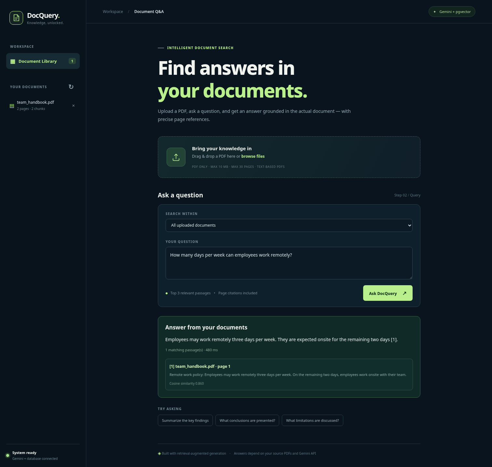
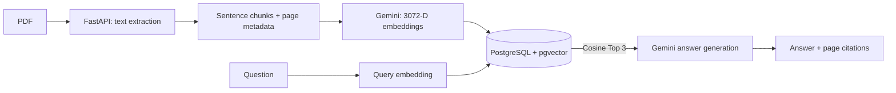

# DocQuery — AI-Powered PDF Question Answering

**Ask questions about PDFs and receive context-aware answers with source-page citations.** An end-to-end retrieval-augmented generation (RAG) portfolio project using **FastAPI, Gemini embeddings (3,072 dimensions), PostgreSQL, and pgvector**.



*UI preview uses stubbed API responses and synthetic sample data; it is not a recorded Gemini result.*

[](https://github.com/Sumit1153/docquery-rag-pdf-qa/actions/workflows/ci.yml)


## What problem does it solve?

Long PDFs are difficult to search manually. DocQuery finds **semantically relevant passages**, feeds them to a Gemini generation model, and returns an answer together with filename and page number information. Unlike a basic chatbot, it uses retrieved PDF text to ground the response.

## Features

- **Upload and index PDF files** — page-aware text extraction with pypdf and sentence-based chunking/overlap.
- **3072-dimensional Gemini embeddings** — `gemini-embedding-001` for both document and query vectors, using task-specific embedding settings.
- **SQL vector search** — PostgreSQL + pgvector, cosine-distance `<=>`, top **3** passages, optional per-document filter.
- **Cited answers** — excerpt markers `[1]`, `[2]`, `[3]` and structured sources including **filename, page, text snippet and similarity**.
- **Document management** — list documents, skip exact duplicates using SHA-256, delete document and its chunks.
- **FastAPI REST endpoints** — automatic interactive `/docs` API documentation.
- **Browser interface** — PDF drag/drop, searchable document list, document selection, cited answer cards and status messages.
- **Docker Compose** — API and `pgvector/pgvector:pg16` database.
- **Automated offline tests** — PDF parser, chunking, service pipeline, and API with fake providers (no secrets needed).

### Architecture



The system **retains extracted text and embeddings**, not uploaded PDF binaries. Read [detailed architecture and tradeoffs](docs/ARCHITECTURE.md).

## Quick start (Windows, easiest: Docker Desktop)

Prerequisites: **Docker Desktop** running; a **Gemini API key** from [Google AI Studio](https://aistudio.google.com/apikey). API access and quota depend on your account and may have a cost.

Open the project folder in VS Code, then run in PowerShell:

```powershell
Copy-Item .env.example .env
notepad .env
```

In Notepad set `GEMINI_API_KEY=your_actual_key`. Save. Then run:

```powershell
docker compose up --build
```

Open **http://127.0.0.1:8000** (dashboard) or **http://127.0.0.1:8000/docs** (REST API). On first startup the app creates its database tables automatically.

**Do not upload `.env` to GitHub**. `.gitignore` excludes it. To stop: press Ctrl+C then `docker compose down` (database contents remain in a Docker volume).

### Alternative: run Python in VS Code, Postgres in Docker

```powershell
Copy-Item .env.example .env
notepad .env
# Set GEMINI_API_KEY, save, then:
docker compose up -d db
python -m venv .venv
.\.venv\Scripts\python.exe -m pip install -r requirements-dev.txt
.\.venv\Scripts\python.exe -m uvicorn app.main:app --reload
```

Open **http://127.0.0.1:8000**. You don't need to activate `.venv` because the commands use its Python executable directly.

### First sample question

Upload [`sample_data/team_handbook.pdf`](sample_data/team_handbook.pdf), then ask:

> How many days per week can employees work remotely?

The **synthetic sample handbook** says **three days per week** on page 1. The response should show the cited source page. The actual wording can vary because generation is nondeterministic.

## API reference

| Endpoint | Method | Purpose |
| --- | --- | --- |
| `/` | GET | Web dashboard |
| `/api/health` | GET | Database and API key configuration |
| `/api/documents` | GET | List uploaded PDFs |
| `/api/documents` | POST | Upload PDF (multipart `file`) |
| `/api/documents/{id}` | DELETE | Remove PDF metadata and its embedded chunks |
| `/api/ask` | POST | Ask a question and retrieve cited evidence |
| `/docs` | GET | Swagger / interactive OpenAPI docs |

Example question:

```json
{"question":"What are the main findings?", "document_id":null}
```

Example response shape (illustrative, not a live result):

```json
{
  "answer":"Remote work is permitted three days per week [1].",
  "sources":[{"ref":1,"filename":"team_handbook.pdf","page":1,"similarity":0.82,"snippet":"Employees may work remotely...","document_id":"00000000-0000-0000-0000-000000000001"}],
  "retrieval_count":1,
  "latency_ms":460
}
```

`document_id` may be omitted/null to search the entire uploaded library. Similarity values are **cosine similarity, not answer confidence**.

## Tests

Run offline tests on Windows:

```powershell
.\.venv\Scripts\python.exe -m pytest -q
```

These tests use stubs: **you don't need Postgres or a Gemini API key to run them**. The GitHub Actions workflow runs the same suite. For actual end-to-end verification, follow [the live verification checklist](docs/VERIFICATION.md).

## Source and data limits

- Only **text-based PDFs**: scanned pages / image-only files require OCR (not included).
- Max **10 MB**, **30 pages**, **150 text chunks** per PDF for this interactive local demo.
- PDFs are processed synchronously; large docs may take time and incur Gemini costs.
- A response can still be inaccurate: the model is instructed to use only retrieved excerpts, but the instruction is **not a guarantee** against hallucinations or prompt injection.
- pgvector stores `VECTOR(3072)` at full precision and uses **exact cosine search**. Standard indexed `vector` HNSW/IVFFlat supports up to 2000 dimensions, so this version does **not** claim a vector ANN index or production scale. See [pgvector's dimension notes](https://github.com/pgvector/pgvector).
- **Local single-user demo only:** no user login, user isolation, OCR, malware scanning, durable upload queue, or public-hosting security hardening. **Do not publish the app openly or upload confidential documents.**

## Project layout

```text
DocQuery/
├── app/
│   ├── main.py            # FastAPI routes
│   ├── service.py         # RAG ingestion + question flow
│   ├── pdf_processing.py  # Page extraction and chunking
│   ├── gemini_client.py   # Embeddings and grounded answers
│   ├── repository.py      # SQL + pgvector queries
│   ├── schemas.py         # Request/response validation
│   └── config.py          # Settings
├── static/                # Browser interface
├── sample_data/           # Synthetic 2-page sample PDF
├── tests/                 # Offline automated tests
├── docs/                  # Architecture, screenshot, verification
├── .github/workflows/     # Automated CI tests
├── compose.yaml           # PostgreSQL and API containers
├── Dockerfile
├── requirements.txt
├── requirements-dev.txt
├── .env.example
└── README.md
```

## How it compares to a basic LLM chatbot

| Basic chatbot | DocQuery RAG |
| --- | --- |
| Uses general model knowledge | Searches your indexed PDF text |
| Doesn't know your PDFs | Page-aware chunk retrieval |
| Usually no original page references | Returns filename + page + excerpt metadata |
| No document storage | PostgreSQL with 3072-D embedding vectors |

## Status and honest verification

**Implemented:** parser, chunker, API, UI, Gemini client code, vector SQL, Docker Compose, tests, docs and sample PDF.

**Verified locally:** offline automated tests and the browser interface with stubbed API responses. **Not verified in this build environment:** live Gemini generation/embeddings, an actual PostgreSQL server, and a complete Docker run. Please complete the checklist before claiming live end-to-end performance or production readiness.

## Publish to GitHub

Create a **new empty public repository** named `docquery-rag-pdf-qa`, without adding a README. Open this extracted folder in VS Code and run:

```powershell
git init
git add .
git commit -m "Initial commit: DocQuery RAG PDF Q&A"
git branch -M main
git remote add origin https://github.com/Sumit1153/docquery-rag-pdf-qa.git
git push -u origin main
```

Before committing, check that `.env`, `.venv`, or generated files aren't staged (`git status --short`).

## License

MIT — see [LICENSE](LICENSE).
