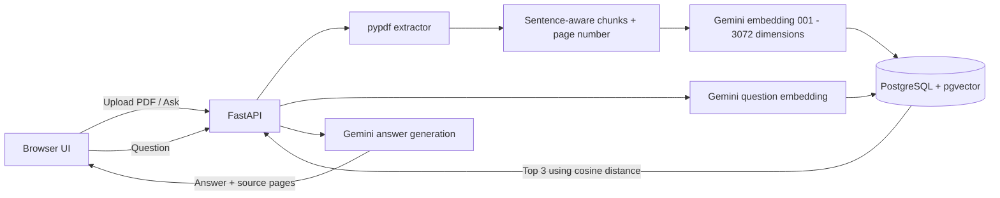

# Technical architecture

## Tables

`documents`: `id`, `filename`, `sha256`, `page_count`, `chunk_count`, `created_at`.

`chunks`: `id`, `document_id`, `page_number`, `chunk_index`, `content`, `embedding VECTOR(3072)`.

The original PDF is **not persisted**; extracted text and vectors are persisted until the user deletes the document. This is not a multi-tenant document vault.

## Search

SQL uses `ORDER BY embedding <=> $1::vector LIMIT 3`, where `<=>` is pgvector's cosine-distance operator. Similarity displayed in the UI is `1 - distance`. Document scoping is handled with a bound UUID parameter.

Exact nearest-neighbor search scans the eligible rows. This keeps full-precision 3,072-dimensional embeddings, but is not optimized for very large libraries. pgvector's regular `vector` HNSW/IVFFlat index only supports up to 2,000 dimensions; a scale-up would need half-precision indexing (`halfvec`, up to 4,000 dimensions), dimensionality reduction, or other tradeoffs. See [pgvector documentation](https://github.com/pgvector/pgvector).

## Design choices and limits

- **Page-aware chunks:** A chunk never crosses a page, so citations accurately name the page that contributed the excerpt.
- **Top-3 retrieval:** Three text chunks are supplied to the LLM; a structured list of the same chunks accompanies the answer.
- **Grounding instruction:** The prompt tells the LLM to answer only from the passages. Hallucinations cannot be fully prevented by this prompt.
- **Duplicate uploads:** SHA-256 identity prevents redundant embedding for identical PDFs.
- **Upload safety:** Only `.pdf` files with a PDF header; at most 10 MB, 30 pages, or 150 chunks. No OCR, antivirus, malware sandbox, or authentication.
- **Privacy:** Extracted PDF text is sent to Google's Gemini API for embeddings and answering. Do not upload sensitive documents without authorization.
- **Cost and latency:** Gemini API requests may use paid quota and take time. API rate limits / quotas apply.
- **Operations:** This is a local portfolio application. Before public deployment add accounts and authorization, per-user data isolation, encrypted secrets, background embedding jobs, database migrations, retries, observability, and abuse controls.

## Request flow

1. Browser posts a PDF to `/api/documents`.
2. FastAPI verifies filename, maximum bytes, and PDF header.
3. pypdf extracts page text; sentence-aware chunker creates bounded text segments.
4. Gemini generates embeddings with task type `RETRIEVAL_DOCUMENT`.
5. PostgreSQL saves the document record and vector chunks in one transaction.
6. Browser asks `/api/ask` with a question and optional document UUID.
7. Gemini generates a `RETRIEVAL_QUERY` embedding. SQL returns the top 3 nearest chunks by cosine distance.
8. Gemini receives these chunks with source markers; the API returns the answer plus file/page metadata for each retrieved chunk.
